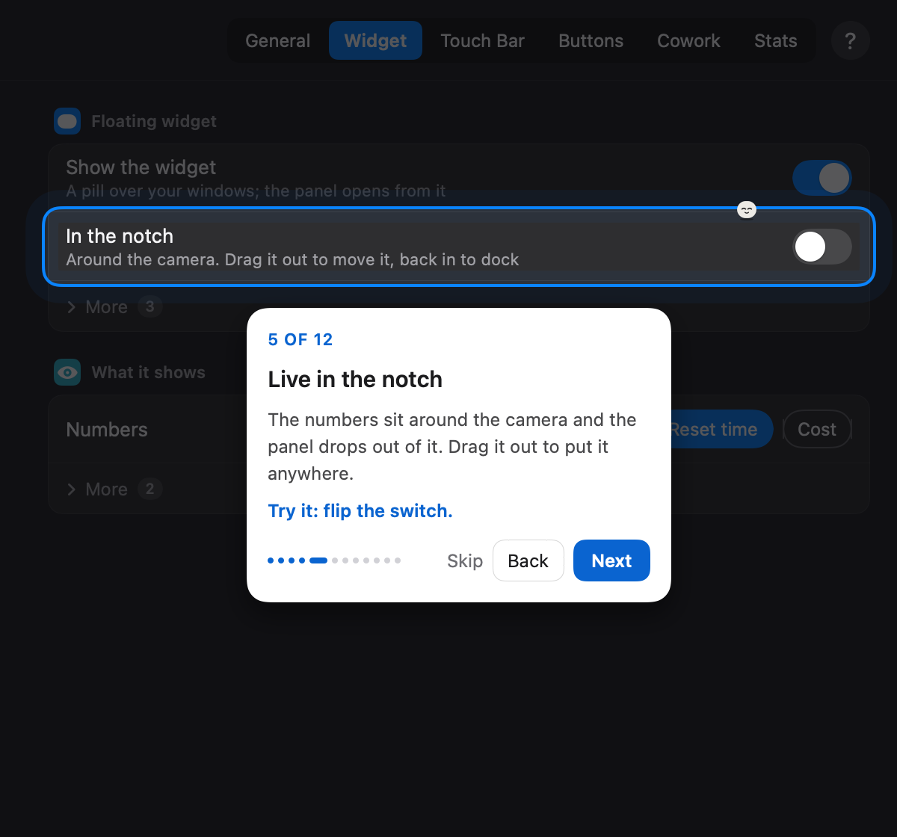

# Clouding Bar

**Claude Code at a glance — on your Touch Bar, in a floating pill, or in the notch.**

<p>
  <a href="../../releases/latest"></a>
  
  
  
  <a href="LICENSE"></a>
</p>

https://github.com/user-attachments/assets/3f0a6442-497e-434e-b389-f8c7f2931a65

<sub>1½ minutes: the Touch Bar, the notch, the pill and the panel, answering Claude, Cowork, dictation, stats.</sub>

Clouding Bar is a small macOS menu bar app for people who work with
[Claude Code](https://code.claude.com). It shows what Claude is doing —
your 5-hour limit, the context window, the model, the subagents at work —
and lets you answer Claude's questions and permission requests without
going back to the chat. Cloud, the little character, dozes while Claude is
idle, hops while it works and waves when it needs you.

It works in the terminal, in the VS Code extension and with the desktop
app, on any Mac with macOS 12 or later. A Touch Bar is a bonus, not a must.
A first version for **Windows** is in [windows/](windows/README.md).

<p align="center">
  
</p>

## What it does

**See where you are**
- **Which chat.** Every chat gets its own colour and goes by its title (the
  one VS Code's tab shows, or the one you gave it), so two chats in one
  project are told apart. Clouding Bar follows the chat in front — VS
  Code's chat tab, a Terminal or iTerm tab — and stays with it when you
  switch to another app. With Claude Desktop in front, it's the chat open
  there. Pick another one in the widget, the menu or the Touch Bar, and
  it's brought up.
- **The chat at work.** When the chat shown finishes while another is still
  working, it says so — a tick, "Done · your turn" — and a moment later
  shows the one at work. Going to another window or tab, or picking a
  chat, puts you back in charge.
- **Another chat done.** When a chat other than the one shown finishes,
  Cloud pops out from behind the pill (or down from the notch) and says
  which — click it to go there — then ducks back; the Touch Bar says it
  too, with Open and OK. Quiet in do not disturb (Settings → Widget → More).
- **The pill** floats over your windows: which chat, the 5-hour limit, the
  context, when the limit resets, the model, lines changed, the git branch,
  subagents. Pull its outline to resize it — wider shows more, taller
  stands it up as a column, pulled thinnest it keeps just the bars — and
  drag items onto each other to reorder.
- **The notch.** Drag the pill to the top of the screen and it docks in the
  notch, the numbers on either side of the camera. Macs without a notch get
  a drawn one. When Claude asks something, the notch grows so you can
  answer right there; drag it out to put it anywhere again.
- **The panel** opens from the pill (hover for 2 seconds, or click): your
  chats as tabs, the one shown lit in its colour; the 5-hour limit and the
  context as two lines (the context as "312k of 1M"); the model, lines,
  branch and subagents; and a message box that says which chat it writes to.
- **The Touch Bar** turns into Claude's bar while your terminal or VS Code
  is in front — or in every app, if you like (there short, beside Apple's
  brightness and volume, with a button that opens the whole bar and one
  that folds it back): which chat (tap it for the others), meters, the model,
  subagents, lines, branch, cost, **Write** (a message to the chat, typed
  or dictated), **Templates**, your buttons, the mic — each one optional.
- Limits are blue, orange from 70%, red from 90% — everywhere.

**Answer Claude**
- Permission requests: **Allow**, **Always allow**, **Deny** — from the
  Touch Bar, the notch or the panel, each saying which chat it comes from.
  Answers go back through Claude Code's own hooks, not keystrokes.
- Questions (`AskUserQuestion`): tap an option, pick several, or type your
  own answer — on the Touch Bar you can even dictate it.
- If Clouding Bar isn't there to answer, Claude asks in its own UI as
  always. It never keeps Claude waiting.

**Answer Cowork too**
- A question that Cowork (or any chat in Claude Desktop) asks in its window
  shows up on the Touch Bar and in the widget, and your pick is pressed
  there for you — read from the window, so the chat has to be open in
  Claude Desktop on the screen you're on.

**Talk to Claude**
- **Chat line** in the pill and the panel. In VS Code (with Settings →
  General → VS Code → Set Up) the message goes straight into the chat's
  Claude — wherever you are, no window switched — screenshots as pictures,
  and the chat shows it as yours. Elsewhere it waits in the queue until
  Claude has finished its reply and its chat is in front (or tap Send now).
- **Drop files** on the widget: they go to that project's chat with your
  next message.
- **Buttons** for your own phrases, slash commands, key presses and links,
  with global shortcuts and a set per project. **Templates** with
  `{project}`, `{branch}`, `{clipboard}`, `{date}`.
- **Dictation**: hold the right ⌥ key, or tap the mic. On macOS 26 and later
  it's the system's own dictation model, on this Mac: English gets its
  commas and full stops by itself; in Russian (whose model doesn't add
  them) say them — «запятая», «точка», «вопросительный знак». Pauses are fine:
  the widget shows the words as you speak, growing with them, then lets you
  check and edit them before you Send (or type them straight in, if you
  prefer — Settings → General → Voice).
- **Screenshot** an area of the screen straight into the chat (taken from
  another app, it's attached to the chat shown and goes with your next
  message).

**Steer it**
- Switch the **model and effort** from the panel or the Touch Bar.
- See which **subagents** are working and what each is doing right now.
- A warning when the **context** fills up, with one tap to `/compact` (or
  let it compact by itself).

**Codex too (beta)**
- Clouding Bar can follow OpenAI's **Codex** as well: its sessions, its own
  5-hour and weekly limits, its context, and its permission requests
  (Settings → General → Codex → Connect, then trust the hooks once with
  `/hooks` in Codex). It's little tested yet — tell us what doesn't work.

**And**
- A **tour** on first launch (and behind the ? in Settings): thirteen stops
  through the settings window — it dims but for one thing at a time, a card
  says what it is and what to try, and Cloud hops onto it.
- **Everything is optional**: each number, detail and control has its own
  switch in Settings. What most people need is up front; the rest waits
  behind **More**.
- **Stats**, the way Claude Code's /stats puts them: both limits; for the
  week, the month or everything, your sessions, active time, tokens and
  days in a row, your favourite model and peak hour; every day of the last
  half year as a square (point at one to see it); the projects the time
  went to — for Claude Code, Cowork or both. From local transcripts (and
  what the Cowork plugin reports), kept after Claude Code clears old ones.
- **Cowork** chats show up too, through Clouding Bar's plugin installed in
  Claude Desktop: it notes each task's name and context in a folder you
  connected to it, where Clouding Bar picks it up — two tasks in one folder
  are two chats.
- **Keeps itself up to date**: once a day it looks on GitHub for a newer
  release and offers it — one click, checked before it's installed.

<p align="center">
  
  
</p>
<p align="center">
  
  
</p>

## Install

### From Claude Code: the plugin

In Claude Code — the terminal, VS Code or Claude Desktop's Code tab:

```
/plugin marketplace add nikolanaidenko-eng/clouding-bar
/plugin install clouding-bar@clouding-bar
/clouding-bar:install
```

The plugin links Claude Code to the app (its hooks). `/clouding-bar:install`
gets the newest release from GitHub, checks it — signed with Clouding Bar's
Developer ID, notarized by Apple — and puts it in Applications. When the app
opens, say **Connect**: it adds its status line to `~/.claude/settings.json`
(the 5-hour limit and the context come that way, and a plugin can't bring a
status line). Then allow Accessibility. From then on a new Claude session
opens Clouding Bar if it's closed (Settings → General → Open with Claude).

**Cowork, if you use it:** in Claude Desktop → Customize → Plugins, add the
same marketplace (`nikolanaidenko-eng/clouding-bar`) and install
**clouding-bar** — the same plugin, in Cowork too. Clouding Bar turns its
Cowork status on by itself (Settings → Cowork: off, thresholds, every reply).
A plugin installed in Claude Desktop also comes to Claude Code with your
claude.ai account, so there you only need the app: `/clouding-bar:install`,
or the .dmg below.

### Download

Get the latest `Clouding-Bar-<version>.dmg` from
[Releases](../../releases), open it and drag **Clouding Bar** into
Applications. Releases are signed and notarized by Apple.

Test builds (marked *beta*) aren't notarized yet, so on first launch macOS
says it can't check the app for malware. Click **Done**, then open
**System Settings → Privacy & Security**, scroll down to *"Clouding Bar"
was blocked* and click **Open Anyway** (on macOS 14 and earlier,
right-click the app → **Open** works too). Or, in Terminal:

```sh
xattr -dr com.apple.quarantine "/Applications/Clouding Bar.app"
```

On first launch it asks to **connect to Claude Code**: it adds a small hook
and a status line to `~/.claude/settings.json` (only the status line, with
the plugin in). Your settings are merged, never replaced, and backed up to
`~/.cloudingbar/backups` first. Then the tour opens.

### Updates

Once a day Clouding Bar asks GitHub whether a newer release is out and
offers it: the menu bar icon → **Install Update**, or Settings → General →
Updates. It's downloaded, checked like the first one (Clouding Bar's
Developer ID, notarized by Apple), put in place of the old copy and opened;
your settings and permissions stay. Turn the daily check off there. A build
of your own (`make install`) isn't touched.

The plugin updates through Claude Code: `/plugin marketplace update
clouding-bar`, or `/plugin` → Marketplaces → clouding-bar → Enable
auto-update.

### Build from source

You need the Xcode Command Line Tools (`xcode-select --install`).

```sh
git clone https://github.com/nikolanaidenko-eng/clouding-bar
cd clouding-bar
make install
```

This builds the app into `~/Applications`, puts the hook programs in
`~/.cloudingbar` and registers them with Claude Code (merged, backed up).

### Permissions macOS asks for

One is needed; the rest are asked the first time you use what needs them,
and only once — updates keep them.

| Permission | Why | |
|---|---|---|
| Accessibility | to type your buttons, templates and chat lines into Claude's chat, and to read window titles | needed |
| Automation (Terminal, iTerm) | to tell which tab is in front, and bring a chat's tab forward | only for chats in a terminal |
| Microphone, Speech Recognition | dictation | only if you dictate |
| Screen Recording | the screenshot button | only if you use it |

Clouding Bar doesn't ask for your Documents or Desktop: the git branch of a
project there is read by the hook, inside Claude Code. (With Cowork on, a
folder you connected to Cowork there is read by the app, so macOS asks once.)

### VS Code

Claude's panel in VS Code doesn't run the status line, so the 5-hour limit
reaches Clouding Bar through a small wrapper instead: **Settings → General
→ VS Code: limit and sending → Set Up** (it sets
`claudeCode.claudeProcessWrapper`, keeping your settings file as it is).
New chats report the limit from then on — and take the widget's messages
straight into Claude's input, beside the extension's own, so nothing is
typed and no window comes forward.

## How it works

```
Claude Code ──hooks──▶ cloudingbar-hook ──unix socket──▶ Clouding Bar ──▶ pill · notch · panel · Touch Bar
     ▲                        │                               │
     └──── the answer ◀───────┘◀────── Allow / an option ─────┘
```

- Claude Code's [hooks](https://code.claude.com/docs/en/hooks) — the
  plugin's, or ours in `~/.claude/settings.json` (never both at once) — tell the app
  when a session starts and stops, when Claude works, which tools and
  subagents run, and when it needs a permission or an answer. For those,
  the hook waits for your choice and hands it back to Claude — or steps
  aside within two seconds if the app isn't running.
- The **status line** brings the 5-hour limit and the context; in VS Code,
  the wrapper does. The session's **transcript** adds the model, token
  counts and lines changed.
- The chat shown is the one in front: by its title in the window (VS Code's
  chat tab, the terminal's title), by its terminal tab (Terminal, iTerm),
  else the one you picked or followed last.
- Buttons, templates and chat lines are typed into the chat in front, the
  way you would.

The protocol is written down in [docs/protocol.md](docs/protocol.md).

### Private by design

Clouding Bar talks only to Claude Code on your Mac. There is no account,
no analytics, no server. It never reads Claude Code's credentials.

Two exceptions. The **update check**: once a day a plain request to
GitHub's public list of this project's releases — nothing about you, no
identifier — and the download, when you install one (Settings → General →
Updates turns the check off). And, opt-in, **Settings → Cowork → Live limit via
claude.ai**, which reads your account-wide limit (desktop and Cowork chats
included) from claude.ai with your session key. The key stays in your
Keychain, behind a helper that answers only Clouding Bar, and goes only to
claude.ai, at most once a minute. That address isn't an official API and
may stop working.

## Settings

The menu bar icon → **Settings…** Light or dark, as macOS is or as you pick.
Cloud keeps you company there: it sits in the corner, hops from row to row
as you move the pointer, and walks along the tabs.

- **General** — appearance (auto, light, dark), colourful or grey buttons,
  open at login (and with Claude), do not disturb, updates, the Claude Code
  connection (and Codex, in beta, and the 5-hour limit in VS Code), the
  context warning, the dictation language.
- **Widget** — show it, in the notch; behind More: follow the chat at
  work, keep the pill visible, open on hover, its position; what it shows
  (a chip for each thing).
- **Touch Bar** — on or off, in every app or only Claude's, what it shows
  (everything the widget can, and Write and Templates), with a live
  preview.
- **Buttons** — your buttons and their shortcuts, a set per project;
  templates.
- **Cowork** — how often it reports, the plugin (or its zip, to upload)
  and its folders; behind More, the claude.ai limit.
- **Stats** — see above.

Everything is stored in `~/.cloudingbar/config.json`; every key is
optional.

<p align="center">
  
  
</p>
<p align="center">
  
</p>

## Uninstall

1. Quit Clouding Bar (its menu bar icon → Quit) and delete it from Applications.
2. The plugin: `/plugin uninstall clouding-bar@clouding-bar` in Claude Code,
   and remove it in Claude Desktop → Customize → Plugins if it's there.
3. Remove the entries pointing to `~/.cloudingbar/cloudingbar-hook` from
   the `hooks` section of `~/.claude/settings.json`, and its `statusLine`
   (your previous status line command is in
   `~/.cloudingbar/statusline-original`).
4. In VS Code, remove `claudeCode.claudeProcessWrapper` if you set it up.
5. `rm -rf ~/.cloudingbar`, and in folders you connected to Cowork, their
   `.clouding-bar` folder.

## Development

```sh
make            # build the app and the helpers into build/
make install    # …and install them
make test       # core checks
make snapshots  # every screen as PNGs in build/snapshots
make demo       # docs/demo.gif, recorded from animated scenes (tools/demo)
make release    # universal, Developer ID-signed, notarized .dmg (see packaging/release.sh)
```

Plain `swiftc`, no Xcode project. Sources: `Sources/CloudingBar` (the app),
`Sources/CloudingBarHook` (the hook), `Sources/CloudingBarTap` (the VS Code
wrapper's tap), `Sources/CloudingBarKey` (the Keychain helper).

## License

[PolyForm Shield 1.0.0](LICENSE): use it, change it and share it for any
purpose — at home or at work — except to provide a product that competes
with Clouding Bar.

Clouding Bar is not affiliated with or endorsed by Anthropic. Claude is a
trademark of Anthropic, PBC.
