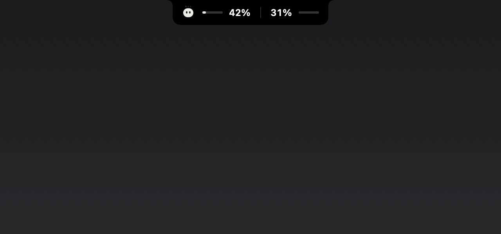

# Clouding Bar

**Claude Code at a glance — on your Touch Bar, in a floating pill, or in the notch.**

<p align="center">
  
</p>

Clouding Bar is a small macOS menu bar app for people who work with
[Claude Code](https://code.claude.com). It shows what Claude is doing —
your 5-hour limit, the context window, the model, the subagents at work —
and lets you answer Claude's questions and permission requests without
going back to the chat. Cloud, the little character, dozes while Claude is
idle, hops while it works and waves when it needs you.

It works in the terminal, in the VS Code extension and with the desktop
app, on any Mac with macOS 12 or later. A Touch Bar is a bonus, not a must.
A first version for **Windows** is in [windows/](windows/README.md).

<p align="center">
  
</p>

## What it does

**See where you are**
- **Which chat.** Every chat gets its own colour and goes by its title (the
  one VS Code's tab shows, or the one you gave it), so two chats in one
  project are told apart. Clouding Bar follows the chat in front — VS
  Code's chat tab, a Terminal or iTerm tab — and stays with it when you
  switch to another app. Pick another one in the widget, the menu or the
  Touch Bar, and it's brought up.
- **The pill** floats over your windows: which chat, the 5-hour limit, the
  context, when the limit resets, the model, lines changed, the git branch,
  subagents. Pull its outline to resize it — wider shows more, taller
  stands it up as a column, pulled thinnest it keeps just the bars — and
  drag items onto each other to reorder.
- **The notch.** Drag the pill to the top of the screen and it docks in the
  notch, the numbers on either side of the camera. Macs without a notch get
  a drawn one. When Claude asks something, the notch grows so you can
  answer right there; drag it out to put it anywhere again.
- **The panel** opens from the pill (hover for 2 seconds, or click): your
  chats as tabs, the one shown lit in its colour; the 5-hour limit and the
  context as two lines (the context as "312k of 1M"); the model, lines,
  branch and subagents; and a message box that says which chat it writes to.
- **The Touch Bar** turns into Claude's bar while your terminal or VS Code
  is in front: which chat (tap it for the others), meters, your buttons,
  the model, the mic.
- Limits are blue, orange from 70%, red from 90% — everywhere.

**Answer Claude**
- Permission requests: **Allow**, **Always allow**, **Deny** — from the
  Touch Bar, the notch or the panel, each saying which chat it comes from.
  Answers go back through Claude Code's own hooks, not keystrokes.
- Questions (`AskUserQuestion`): tap an option, pick several, or type your
  own answer — on the Touch Bar you can even dictate it.
- If Clouding Bar isn't there to answer, Claude asks in its own UI as
  always. It never keeps Claude waiting.

**Talk to Claude**
- **Chat line** in the pill and the panel: write now, it's sent when
  Claude has finished its reply and its chat is in front.
- **Drop files** on the widget: they go to that project's chat with your
  next message.
- **Buttons** for your own phrases, slash commands, key presses and links,
  with global shortcuts and a set per project. **Templates** with
  `{project}`, `{branch}`, `{clipboard}`, `{date}`.
- **Dictation**: hold the right ⌥ key, or tap the mic.
- **Screenshot** an area of the screen straight into the chat.

**Steer it**
- Switch the **model and effort** from the panel or the Touch Bar.
- See which **subagents** are working and what each is doing right now.
- A warning when the **context** fills up, with one tap to `/compact` (or
  let it compact by itself).

**Codex too**
- Clouding Bar can follow OpenAI's **Codex** as well: its sessions, its own
  5-hour and weekly limits, its context, and its permission requests
  (Settings → General → Codex → Connect, then trust the hooks once with
  `/hooks` in Codex).

**And**
- A **tour** on first launch (and behind the ? in Settings): twelve stops
  through the settings window — it dims but for one thing at a time, a card
  says what it is and what to try, and Cloud hops onto it.
- **Everything is optional**: each number, detail and control has its own
  switch in Settings. What most people need is up front; the rest waits
  behind **More**.
- **Stats**: both limits, your week hour by hour (point at an hour for that
  hour and that day), where the time went — from local transcripts.
- **Cowork** chats can report their context through a small plugin.

<p align="center">
  
  
</p>
<p align="center">
  
  
</p>

## Install

### Download

Get the latest `Clouding-Bar-<version>.dmg` from
[Releases](../../releases), open it and drag **Clouding Bar** into
Applications. Releases are signed and notarized by Apple.

Test builds (marked *beta*) aren't notarized yet, so on first launch macOS
says it can't check the app for malware. Click **Done**, then open
**System Settings → Privacy & Security**, scroll down to *"Clouding Bar"
was blocked* and click **Open Anyway** (on macOS 14 and earlier,
right-click the app → **Open** works too). Or, in Terminal:

```sh
xattr -dr com.apple.quarantine "/Applications/Clouding Bar.app"
```

On first launch it asks to **connect to Claude Code**: it adds a small hook
and a status line to `~/.claude/settings.json`. Your settings are merged,
never replaced, and backed up to `~/.cloudingbar/backups` first. Then the
tour opens.

### Build from source

You need the Xcode Command Line Tools (`xcode-select --install`).

```sh
git clone https://github.com/nikolanaidenko-eng/clouding-bar
cd clouding-bar
make install
```

This builds the app into `~/Applications`, puts the hook programs in
`~/.cloudingbar` and registers them with Claude Code (merged, backed up).

### Permissions macOS asks for

One is needed; the rest are asked the first time you use what needs them,
and only once — updates keep them.

| Permission | Why | |
|---|---|---|
| Accessibility | to type your buttons, templates and chat lines into Claude's chat, and to read window titles | needed |
| Automation (Terminal, iTerm) | to tell which tab is in front, and bring a chat's tab forward | only for chats in a terminal |
| Microphone, Speech Recognition | dictation | only if you dictate |
| Screen Recording | the screenshot button | only if you use it |

Clouding Bar doesn't ask for your Documents or Desktop: the git branch of a
project there is read by the hook, inside Claude Code.

### VS Code

Claude's panel in VS Code doesn't run the status line, so the 5-hour limit
reaches Clouding Bar through a small wrapper instead: **Settings → General
→ 5-hour limit in VS Code → Set Up** (it sets
`claudeCode.claudeProcessWrapper`, keeping your settings file as it is).
New chats report the limit from then on.

## How it works

```
Claude Code ──hooks──▶ cloudingbar-hook ──unix socket──▶ Clouding Bar ──▶ pill · notch · panel · Touch Bar
     ▲                        │                               │
     └──── the answer ◀───────┘◀────── Allow / an option ─────┘
```

- Claude Code's [hooks](https://code.claude.com/docs/en/hooks) tell the app
  when a session starts and stops, when Claude works, which tools and
  subagents run, and when it needs a permission or an answer. For those,
  the hook waits for your choice and hands it back to Claude — or steps
  aside within two seconds if the app isn't running.
- The **status line** brings the 5-hour limit and the context; in VS Code,
  the wrapper does. The session's **transcript** adds the model, token
  counts and lines changed.
- The chat shown is the one in front: by its title in the window (VS Code's
  chat tab, the terminal's title), by its terminal tab (Terminal, iTerm),
  else the one you picked or followed last.
- Buttons, templates and chat lines are typed into the chat in front, the
  way you would.

The protocol is written down in [docs/protocol.md](docs/protocol.md).

### Private by design

Clouding Bar talks only to Claude Code on your Mac. There is no account,
no analytics, no server. It never reads Claude Code's credentials.

The one exception is opt-in: **Settings → Cowork → Live limit via
claude.ai** reads your account-wide limit (desktop and Cowork chats
included) from claude.ai with your session key. The key stays in your
Keychain, behind a helper that answers only Clouding Bar, and goes only to
claude.ai, at most once a minute. That address isn't an official API and
may stop working.

## Settings

The menu bar icon → **Settings…** Light or dark, as macOS is or as you pick.
Cloud keeps you company there: it sits in the corner, hops from row to row
as you move the pointer, and walks along the tabs.

- **General** — appearance (auto, light, dark), colourful or grey buttons,
  open at login, do not disturb, the Claude Code connection (and Codex, and
  the 5-hour limit in VS Code), the context warning, the dictation language.
- **Widget** — show it, in the notch; behind More: keep the pill visible,
  open on hover, its position; what it shows (a chip for each thing).
- **Touch Bar** — on or off, what it shows, with a live preview.
- **Buttons** — your buttons and their shortcuts, a set per project;
  templates.
- **Cowork** — the plugin and its folders; behind More, the claude.ai limit.
- **Stats** — see above.

Everything is stored in `~/.cloudingbar/config.json`; every key is
optional.

<p align="center">
  
  
</p>

## Uninstall

1. Quit Clouding Bar (its menu bar icon → Quit) and delete it from Applications.
2. Remove the entries pointing to `~/.cloudingbar/cloudingbar-hook` from
   the `hooks` section of `~/.claude/settings.json`, and its `statusLine`
   (your previous status line command is in
   `~/.cloudingbar/statusline-original`).
3. In VS Code, remove `claudeCode.claudeProcessWrapper` if you set it up.
4. `rm -rf ~/.cloudingbar`

## Development

```sh
make            # build the app and the helpers into build/
make install    # …and install them
make test       # core checks
make snapshots  # every screen as PNGs in build/snapshots
make demo       # docs/demo.gif, recorded from animated scenes (tools/demo)
make release    # universal, Developer ID-signed, notarized .dmg (see packaging/release.sh)
```

Plain `swiftc`, no Xcode project. Sources: `Sources/CloudingBar` (the app),
`Sources/CloudingBarHook` (the hook), `Sources/CloudingBarTap` (the VS Code
wrapper's tap), `Sources/CloudingBarKey` (the Keychain helper).

## Credits

Clouding Bar began as a fork of
[TouchMyBar/claudebar](https://github.com/TouchMyBar/claudebar) (MIT) — a
Touch Bar for Claude Code permission prompts. Thank you!

What changed since:

- Permissions and questions are answered through hooks, not keystrokes,
  and Claude never waits on the app.
- The floating widget: the pill, the notch, the panel, the island.
- The 5-hour limit, context, model, effort, subagents, lines, branch, cost.
- Questions with options and typed or dictated answers.
- Buttons with types, shortcuts and per-project sets; templates; the chat
  queue; file drop; screenshots; dictation.
- Model and effort switching; the subagents list; chats told apart by
  title and colour, followed by the window or tab in front.
- Cowork, Stats, the settings window (light and dark) and the tour.
- The "skip permissions" button is gone.

## License

MIT — see [LICENSE](LICENSE).

Clouding Bar is not affiliated with or endorsed by Anthropic. Claude is a
trademark of Anthropic, PBC.
