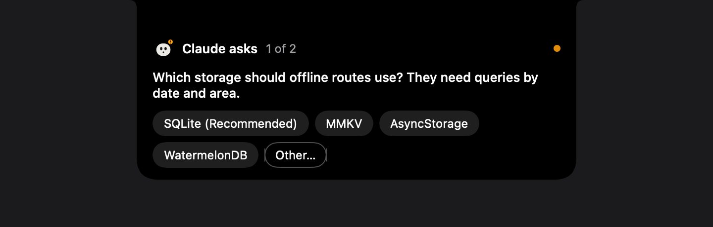
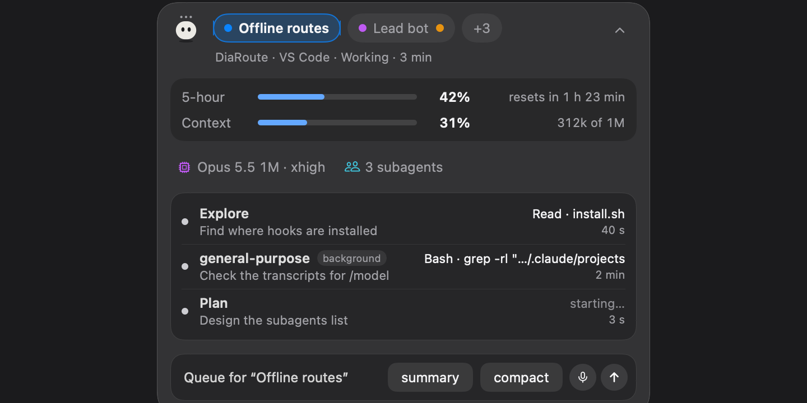
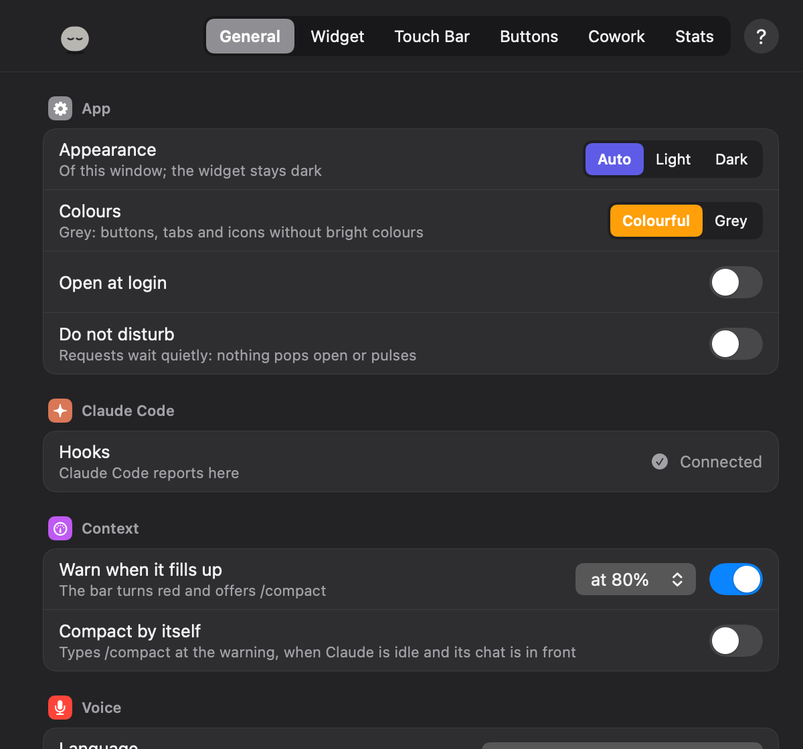
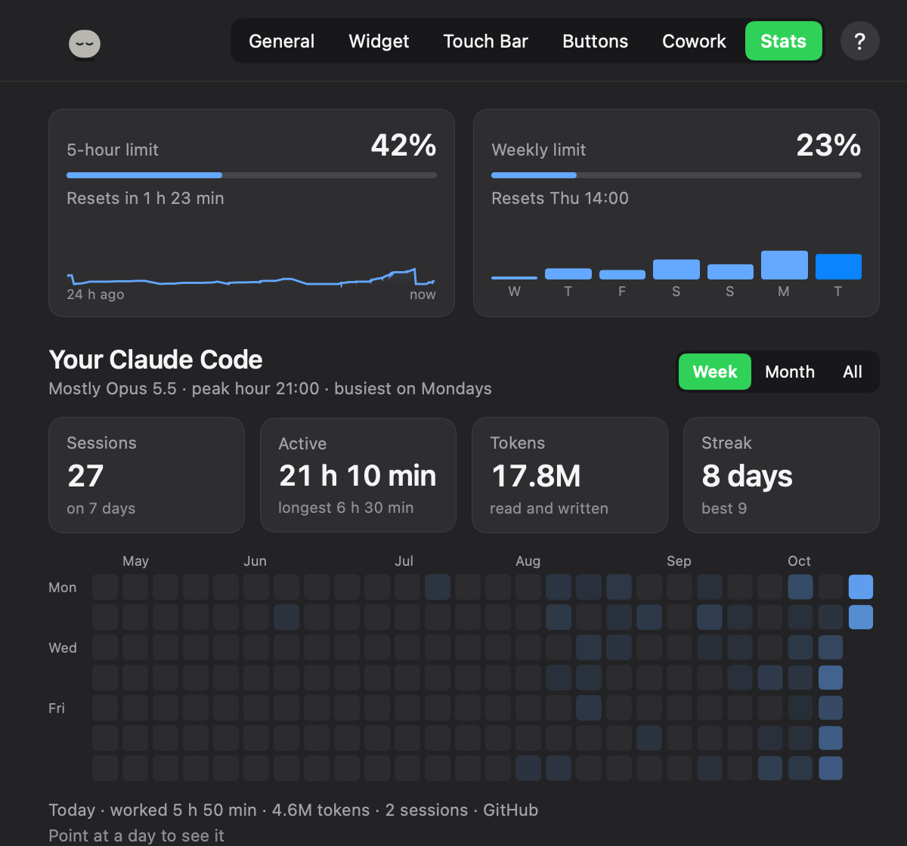

# Clouding Bar

**Claude Code at a glance — on your Touch Bar, in a floating pill, or in the notch.**

<p>
  <a href="https://github.com/wvnikola/clouding-bar/releases/latest"></a>
  
  
  
  <a href="LICENSE"></a>
</p>

https://github.com/user-attachments/assets/ac4b3e46-2d3a-4ece-a3a6-631e319ae3c9

<sub>2 minutes: the Touch Bar, the notch, the pill and the panel, answering Claude, Cowork, dictation, stats.</sub>

Clouding Bar is a small macOS menu bar app for people who work with
[Claude Code](https://code.claude.com). It shows what Claude is doing — your
5-hour limit, the context window, the model, the subagents at work — and lets
you answer Claude's questions and permission requests without going back to
the chat. It works in the terminal, in the VS Code extension and with the
desktop app, on any Mac with macOS 12 or later. A Touch Bar is a bonus, not a
must. A first version for **Windows** is in [windows/](windows/README.md).

<p align="center">
  
</p>
<p align="center">
  
  
</p>
<p align="center">
  
</p>

## What it does

- **See.** Which chat is in front, with its own colour and a short name; its
  5-hour limit, context, model, time at work, lines changed, git branch and
  subagents — in a floating pill, in the notch, in a panel or on the Touch Bar.
  It says when another chat is done and how its answer begins. Stats, the way
  Claude Code's `/stats` puts them, for Claude Code and Cowork.
- **Answer.** Permission requests (Allow, Always allow, Deny) and Claude's
  questions, from the Touch Bar, the notch or the panel, through Claude Code's
  own hooks. If Clouding Bar isn't there, Claude asks in its own UI as always.
- **Send.** Write to a chat from the widget, typed or dictated (hold the right
  ⌥ key). Screenshot an area, or drop files on the widget. Your own buttons:
  phrases, slash commands, key presses, links.
- **Cowork and chats.** After **Sign In…** to claude.ai, Cowork tasks and claude.ai
  chats show up — working, done or waiting for you, with their context. A Cowork
  task's questions and permissions come to the bar, and your messages go to it.
  (The sign-in goes against Anthropic's terms: see [Private by design](#private-by-design).)
- **Codex.** Codex chats show up by themselves, with their limits and context.
  **Connect** adds permission requests on the bar.

All of it, in full: [docs/features.md](docs/features.md).

## Install

One Mac app, installed once, whichever way you get it. What else each place needs:

| Where you work with Claude | What it needs |
|---|---|
| Claude Code — terminal, VS Code, Claude Desktop's Code tab | the app, then **Connect** in it. The plugin is optional |
| Cowork in Claude Desktop | the app, then **Sign In…** to claude.ai in its Settings (read the [warning](#private-by-design) first). The plugin isn't needed |
| Codex | the app, then **Connect** for Codex in it |

> **Cowork needs the claude.ai sign-in, and Anthropic's terms don't allow it.**
> Third-party apps may not collect or store claude.ai session keys, or reach
> claude.ai automatically; signing in goes against that and could put your
> account at risk, including suspension. Anthropic hasn't approved Clouding Bar.
> Use it at your own risk. Everything else works without it. Details:
> [docs/privacy.md](docs/privacy.md#the-claudeai-sign-in-optional).

**1. The plugin, from Claude Code.** Type these inside Claude Code (after `claude`
in a terminal), not in the shell:

```
/plugin marketplace add wvnikola/clouding-bar
/plugin install clouding-bar@clouding-bar
/reload-plugins
/clouding-bar:install
```

`/clouding-bar:install` gets the newest release from GitHub, checks it (signed
with Clouding Bar's Developer ID, notarized by Apple) and puts it in
Applications. When the app opens, say **Connect**, then allow Accessibility.

**2. The .dmg.** [Download the latest](https://github.com/wvnikola/clouding-bar/releases/latest/download/Clouding-Bar.dmg)
(or a version from [Releases](https://github.com/wvnikola/clouding-bar/releases)),
open it and drag **Clouding Bar** into Applications.

**3. From source,** with the Xcode Command Line Tools (`xcode-select --install`):

```sh
git clone https://github.com/wvnikola/clouding-bar
cd clouding-bar
make install
```

Cowork, Codex, VS Code, the permissions macOS asks for, updates:
[docs/install.md](docs/install.md).

## Settings

Menu bar icon → **Settings…**: General, Widget, Touch Bar, Buttons, Stats. The
widget and the Touch Bar are shown there live — drag a block to move it, its
edge to size it. Every setting is optional and kept in `~/.cloudingbar/config.json`.

<p align="center">
  
  
</p>

## Private by design

Clouding Bar talks to Claude Code on your Mac. It has no account of its own,
no analytics and no server, and it never reads Claude Code's credentials. What
leaves your Mac, and when:

- **Short chat names.** Once per chat the app runs your own `claude -p` (Haiku)
  to name it in a word or two: the chat's title and the first 400 letters of
  its first message go to Anthropic through it, where the chat already goes.
  Off in Settings → General → App → More… → Short chat names.
- **Update check.** Once a day, a plain request to GitHub's public list of this
  project's releases. Nothing about you. Off in the same place (Updates).
- **Dictation** is recognised on your Mac. Audio goes to Apple only if you tick
  *Allow sending audio to Apple* (off by default), and only for a language your
  Mac can't do offline.
- **claude.ai sign-in is optional**, off until you use it, and **against
  Anthropic's terms** — at your own risk. Anthropic's terms don't allow
  third-party apps to collect or store claude.ai session keys, or to reach
  claude.ai automatically. Signing in could put your account at risk,
  including suspension, and Anthropic hasn't approved Clouding Bar. Without
  it everything else keeps working, except Cowork tasks, claude.ai chats, the
  account-wide limit and sending to a Claude Desktop or Terminal chat through
  Remote Control without switching windows. If you sign in, the app reads
  your account's limit, Cowork tasks and chats from claude.ai (every 5 s while
  something is going on, every 15 s at rest), and sends what you send from the
  widget to them. The session key lives in the macOS Keychain and goes only to
  claude.ai. These addresses are unofficial and may stop working at any time;
  its messages to chats name claude.ai's web client, and its sign-in window
  Safari. Anthropic's words
  and the details: [docs/privacy.md](docs/privacy.md#the-claudeai-sign-in-optional).
- The start of an answer (shown when a chat is done) stays in memory, never on
  disk; on macOS 26 with Apple Intelligence, Apple's model on your Mac retells
  it. No message text is kept.

Every address, how often it's asked, and what is kept in `~/.cloudingbar`:
[docs/privacy.md](docs/privacy.md).

## Uninstall

1. Quit Clouding Bar (menu bar icon → Quit) and delete it from Applications.
   The plugin: `/plugin uninstall clouding-bar@clouding-bar` in Claude Code, and
   remove it in Claude Desktop → Customize → Plugins if it's there.
2. Remove the entries pointing to `~/.cloudingbar/cloudingbar-hook` from the
   `hooks` section of `~/.claude/settings.json`, and its `statusLine` (your
   previous status line command is in `~/.cloudingbar/statusline-original`).
   In VS Code, remove `claudeCode.claudeProcessWrapper` if you set it up.
3. Sign Out of claude.ai in Settings first, or delete the key from Keychain
   ("Clouding Bar · claude.ai session key"); to end the login session too, log
   out of all devices in claude.ai's settings. Then `rm -rf ~/.cloudingbar`.
   (Older versions: a folder you connected to Cowork may hold a `.clouding-bar`
   folder — safe to delete.)

How it works and how to build it: [docs/how-it-works.md](docs/how-it-works.md), [docs/protocol.md](docs/protocol.md).

## License

[MIT](LICENSE). Clouding Bar is not affiliated with or endorsed by Anthropic,
OpenAI or Apple. Claude is a trademark of Anthropic, PBC; Codex is a trademark of
OpenAI; Mac, macOS and Touch Bar are trademarks of Apple Inc.
